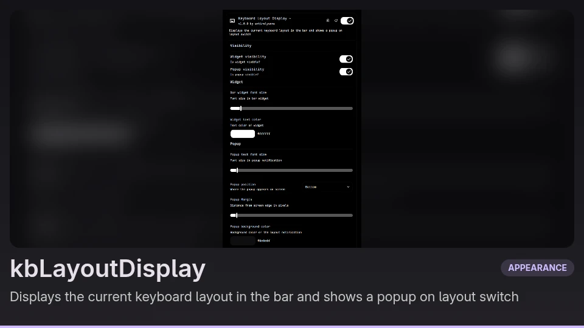

# KbLayoutDisplay

DankMaterialShell widget for displaying current keyboard layout in the bar and showing popup notification when keyboard layout changes.

## Features

- displays keyboard layout in dank bar widget
- displays popup notification when keyboard layout changes
- configurable widget font size and text color
- configurable popup position, margin, text size, background and border
- toggle the widget and the popup visibility independently
- configurable label for different keyboard layouts

## Requirements

Now plugin works only with niri

- DankMaterialShell
- Niri

Tested with niri v.26.04 and dank material shell v1.6.3.

## Installation

- clone repository in `~/.config/DankMaterialShell/plugins/KbLayoutDisplay`
- run `dms ipc call plugin-scan scan`
- then run `dms ipc call plugins enable kbLayoutDisplay`

## Configuration

### Widget

| Option               | Default   | Range  | Description                  |
| -------------------- | --------- | ------ | ---------------------------- |
| Bar widget font size | 10px      | 8-32px | Text size in the bar         |
| Widget text color    | `#ffffff` | color  | Text color of the bar widget |

### Popup

| Option                 | Default       | Range                                      | Description                   |
| ---------------------- | ------------- | ------------------------------------------ | ----------------------------- |
| Popup text font size   | 20px          | 8-100px                                    | Text size in the popup        |
| Popup position         | `Bottom`      | `Center`, `Top`, `Bottom`, `Left`, `Right` | Popup placement on screen     |
| Popup margin           | 100px         | 0-500px                                    | Distance from the screen edge |
| Popup background color | `#302840`     | color                                      | Background color of the popup |
| Popup border color     | `transparent` | color                                      | Border color of the popup     |
| Popup border width     | 0px           | 0-500px                                    | Width of the popup border     |

### Visibility

| Option            | Default | Range      | Description       |
| ----------------- | ------- | ---------- | ----------------- |
| Widget visibility | `on`    | `on`/`off` | Is widget visible |
| Popup visibility  | `on`    | `on`/`off` | Is popup visible  |

## Custom layout labels

Layout labels are configured in `layouts.js`.

- `widgetLayouts` defines labels displayed in the bar
- `popupLabels` defines label displayed in popup notifications.

Each rule contains a `match` string and `displayText` string.

If no rule matches, the original layout name will be displayed.

## Project structure

- `plugin.json` - plugin metadata
- `KbLayoutDisplayWidget.qml` - bar widget, niri event handling and popup notifcation.
- `KbLayoutDisplaySettings.qml` - plugin settings UI.
- `layouts.js` - keyboard layout matching rules and display labels.
